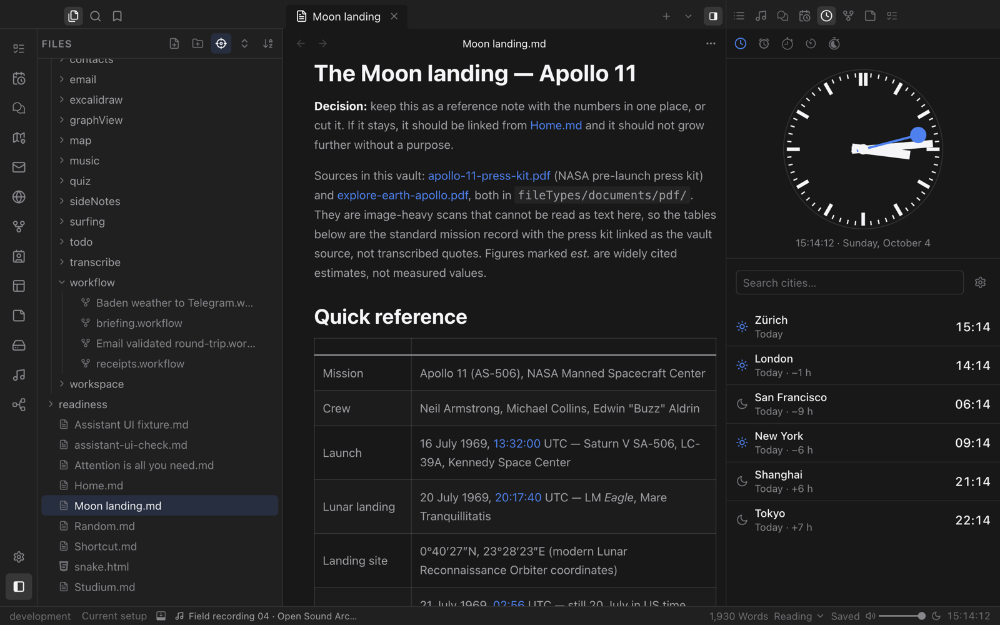
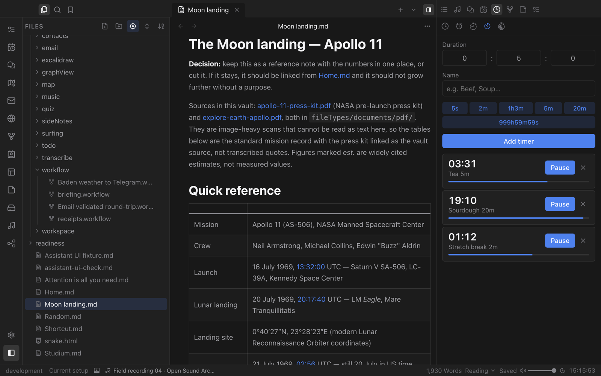
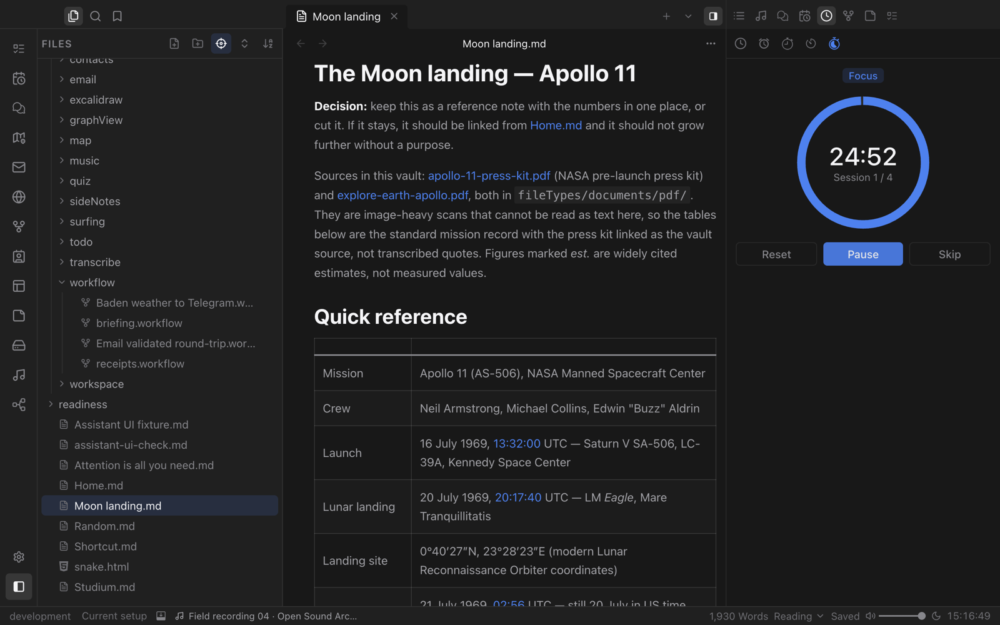

# Clock

World times, alarms, a stopwatch, multiple timers and Pomodoro, all in your right sidebar while you work.

## Around the world

A clean analog face shows the local time, with a list of cities below it. Each city shows its time, the day and its offset from you, and you can add any city with search.

## Timers for everything

Run as many timers as you need at once and give each one a name, such as *Tea* or *Sourdough*. Start common durations from your presets with one click, or type any length up to 999 hours.

## Focus with Pomodoro

Work in focused sessions with breaks in between. The ring shows the time left and which session you are in.

## Alarms and more

- **Alarms** with repeating schedules and your own sounds. Drop audio files into the alarm sounds folder and they appear in the list.
- **Stopwatch** with laps and a smooth digital or analog face.
- **Workflow** can start timers and alarms, or react when they finish.
